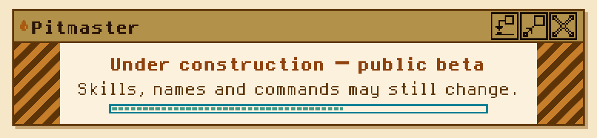
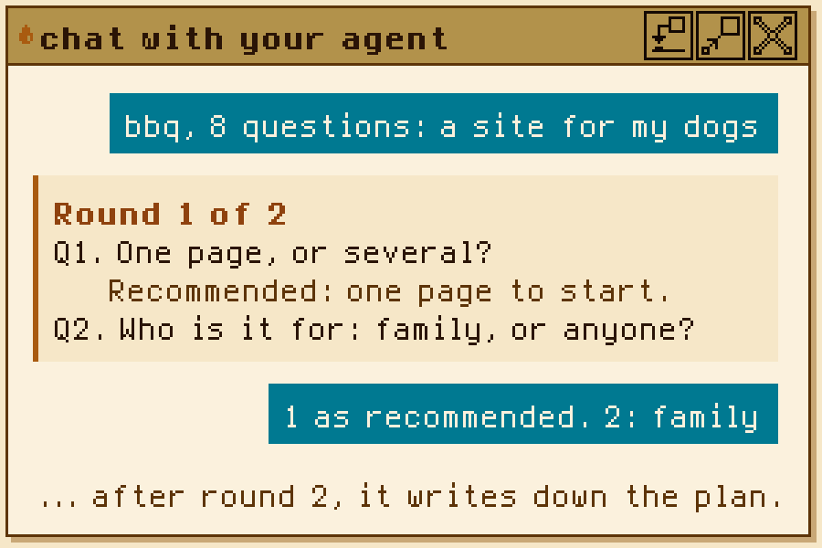
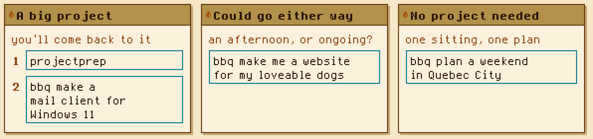
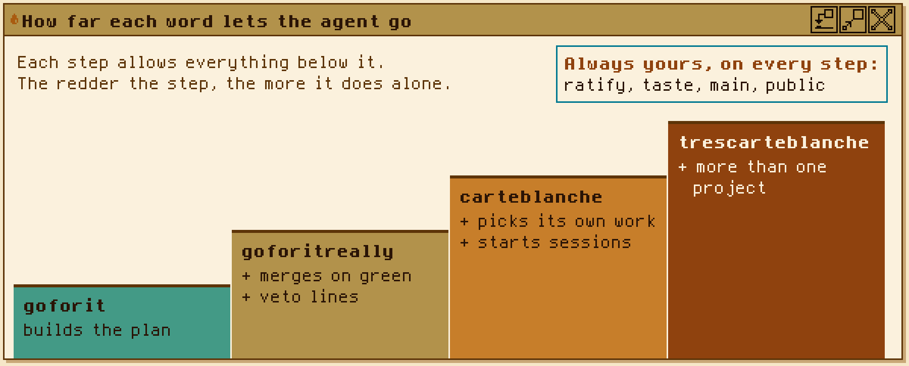

# Pitmaster

<picture>
  <source media="(prefers-color-scheme: dark)" srcset="docs/assets/beta-banner-dark.svg">
  
</picture>

**A plugin of skills, rules and tools that you and your AI agent can use to start new projects or manage existing
ones.**

There are sixteen [skills](#the-skills) so far, and more on the way, for agents like
[Claude Code, Codex and Antigravity](#platform-support). Pitmaster helps you better understand and organize your
project without losing track of all the moving parts.

A plugin for Claude Code and Codex; plain skill folders for everything else. Open source, under the Apache-2.0 licence.

## Use Pitmaster to start a project or help with an existing project

> [!WARNING]
> Some skills let your agent change your project and publish its work. Each says so before it acts, and nothing
> merges unless you allow it. [How far each word lets the agent go](#how-far-each-word-lets-the-agent-go) has the
> details.

Is Pitmaster installed? If not, [install it first](#your-first-five-minutes). Then, in your agent's chat:

<p>
<a href="#skill-project-prep"></a>
<a href="#skill-bbq"></a>
</p>

A bbq works for something that doesn't need a project, too. For example: `bbq help me plan a website for my dogs`.
It asks you questions, then writes down the plan.

Not sure which? [Your first five minutes](#your-first-five-minutes) has examples of both.

Originally, the point of Pitmaster was to be used solely with agents; however, many of the skills use small scripts
that are usable by yourself at a terminal. [The shed](#the-shed) gives you access to those.

## Contents

| section | read it to… |
|---|---|
| [What it is](#what-it-is) | find out who it's for |
| [New to skills and rules?](#new-to-skills-and-rules) | learn what an agent, a rule and a skill are, and what happens when you type "bbq" |
| [What it does](#what-it-does) | install it, try it in five minutes with examples, then pick a skill for a job |
| [The shed](#the-shed) | run a small tool with no agent at all |
| [How far each word lets the agent go](#how-far-each-word-lets-the-agent-go) | compare goforit, goforitreally, carteblanche and trescarteblanche |
| [Install](#install) and [Update](#update) | install it in another agent, or get a new version |
| [Platform support](#platform-support) | check that your agent works with it |
| [Configure](#configure) | change a setting |
| [Help and feedback](#help-and-feedback) | ask a question, report a problem, give feedback |
| [About Pitmaster](#about-pitmaster) | see where it came from, in its author's words |
| [Words](#words) | look up a word, and see which ones are Pitmaster's own |
| [More](#more) | the changelog, how to add a skill, the decisions behind the skills, the licence |

## What it is

**Who it's for.** Trying to organize and work on your projects using AI? Trying to turn vibes into skills? Don't
care about skills, but those scripts look neat? Pitmaster might be for you.

### New to skills and rules?

New to agents, rules and skills? Start here.

An **agent** works inside your project: it reads files, runs commands and makes changes. Claude Code and Codex are
agents, and your agent's settings decide when it must ask first. Tell an agent what to do in the chat, or give it
rules that apply to every session and skills for particular jobs.

A **rule** is a short standing order that applies to every conversation with the agent. The agent reads its rules
before doing anything else, which makes them the place for project-wide policies like "never push straight to main"
or "keep answers short". Rules are kept in a plain text file at the top of your project folder: `CLAUDE.md` for
Claude Code, `AGENTS.md` for Codex and most other agents. The agent loads the whole file at the start of every
session, so a long rules file uses up the agent's context, which is how much it can keep in mind at once, and the
tokens your usage is counted in, before the actual work has even started.

A **skill** is a folder holding one instruction file, `SKILL.md`. Some skills also carry a script or a template to
help carry those instructions out. Skills cost almost nothing until they're used. The agent keeps a short list of
skill names, each with one line on when it applies, and reads a skill's full instructions only when you name it or
your request matches. So a skill can be as detailed as the job needs: steps, questions, and the exact shape of what
gets written down.

| | a rule | a skill |
|---|---|---|
| when the agent reads it | before anything else, in every session | only when you name it or your request matches |
| how long it is | short, often one line | as long as the job needs |
| where it lives | `CLAUDE.md` or `AGENTS.md`, at the top of your project | a folder with a `SKILL.md`, installed or copied in |
| example | "never push straight to main" | bbq: ask questions in rounds, then write down the plan |

Pitmaster is a plugin full of skills, each started by saying its name in chat (or loaded on its own when your request
matches). They range from question sessions (`bbq`) to project set-up (`project-prep`) to `carte-blanche`, which
lets your agent keep working for a whole session without stopping to ask, inside the limits you set, and writes down
every call it made, so you can see each one and ask for it to be undone. Most work alone or combine with others to suit how you work.

**What happens when you type "bbq".**

<picture>
  <source media="(prefers-color-scheme: dark)" srcset="docs/assets/readme-chat-dark.svg">
  
</picture>

1. Type "bbq, ask me 8 questions" in the agent's chat box.
2. The agent recognises the request and reads bbq's instructions.
3. Before asking, the agent looks at your project. If there's a status file (a short note about where the project
   stands), it reads that too. Then it asks questions in numbered rounds, recommending an answer for each one.
4. After the questions, the agent writes a short file recording what you settled, question by question.
5. That file becomes the prompt for work in the same chat or a new one.

Skills change how the agents work; they don't change your permission settings. Skills announce pushes, pull requests
and merges before acting, or report afterwards under carte-blanche. Merging always needs your permission: you either say yes each time, or
give it ahead of time with a word like goforitreally or carteblanche. Included
scripts run only when the agent runs them as commands.

## What it does

### Your first five minutes

**What you need.** Claude Code or Codex (any paid plan works; the usage skills assume a plan with a weekly usage
limit), Cowork or claude.ai for the skill zips, or an open-source agent such as OpenCode, which can also run models
on your own computer. Some skills need a little more. For a bbq, you don't need the extra tools in this table;
project-prep needs `git`.

| you need | what it's for | without it |
|---|---|---|
| `git` | keeps your project's history; any skill that makes branches or commits needs it | those skills can't save their work on a branch |
| GitHub's `gh`, signed in once with `gh auth login` | lets the agent open pull requests on GitHub for you | the work stops at a saved branch, and you open the pull request yourself |
| Python 3.8 or newer | runs the small optional scripts some skills carry | those skills do the same steps by hand |

**Install.** Pick the way that fits:

<details>
<summary>Claude Code: just ask</summary>

Ask Claude to "install the Pitmaster plugin from MapleSyrupOS/pitmaster". It runs the same two steps you could type in a terminal
(`claude plugin marketplace add MapleSyrupOS/pitmaster`, then `claude plugin install pitmaster@pitmaster`). Restart
Claude Code afterwards.

</details>

<details>
<summary>Claude Code: type it</summary>

To install Pitmaster in Claude Code, type these two lines in the chat box, one after the other:

```
/plugin marketplace add MapleSyrupOS/pitmaster
/plugin install pitmaster@pitmaster
```

Restart Claude Code afterwards.

</details>

<details>
<summary>Codex</summary>

Run these in a terminal (the window where you type `codex` to start it), or ask Codex to run them for you:

```
codex plugin marketplace add MapleSyrupOS/pitmaster
codex plugin add pitmaster@pitmaster
```

</details>

<details>
<summary>Cowork or claude.ai</summary>

Download a skill's zip from the [latest release](https://github.com/MapleSyrupOS/pitmaster/releases) (pick the
`claude` build) and upload it in Claude's skill settings, one zip per skill.

</details>

<details>
<summary>Just the shed's tools</summary>

No agent needed. Copy a tool's folder from [`pitmaster-shed`](https://github.com/MapleSyrupOS/pitmaster-shed) into
your project, or use the shed as a [pre-commit](https://pre-commit.com) hook repository. Each tool's README says how
to run it.

</details>

Every other way, and how to update, is under [Install](#install) and [Update](#update).

**Did it work?** Ask your agent "can you see Pitmaster's bbq skill?" It should say yes and describe it.

**Which one first?** Ask yourself: *will you come back to it over many sessions?* Then prep it as a project
first, and have a bbq to plan it. *One sitting, or one plan?* Just have a bbq.

<picture>
  <source media="(prefers-color-scheme: dark) and (max-width: 700px)" srcset="docs/assets/readme-examples-narrow-dark.svg">
  <source media="(max-width: 700px)" srcset="docs/assets/readme-examples-narrow-light.svg">
  <source media="(prefers-color-scheme: dark)" srcset="docs/assets/readme-examples-dark.svg">
  
</picture>

<details>
<summary>More examples to copy</summary>

| A big project | Could go either way | No project needed |
|---|---|---|
| `projectprep`, then `bbq make a mail client for Windows 11` | `bbq make me a website for my loveable dogs` | `bbq plan a weekend in Quebec City` |
| `projectprep`, then `bbq make a recipe app for my family` | `bbq make a site for my small bakery` | `bbq help me choose between two laptops` |
| `projectprep`, then `bbq make a little puzzle game` | `bbq write a newsletter for my running club` | `bbq plan my kid's birthday party` |

</details>

The middle one depends on you: one afternoon on the dogs' website, and a bbq is enough; if it will grow, with a
gallery and updates, prep it first. project-prep doesn't build anything itself: it sets up the folder you and your
agents will share, and your bbq plans what goes in it. It works in the folder your agent has open, and offers to set
up `git` there if it isn't yet. Starting from just an idea? Make an empty folder, open your agent in it, then type
`projectprep`. To open your agent in a folder: in the Claude or Codex app, pick the folder when you start a session;
in a terminal, go to the folder and type `claude` or `codex`.

**More ways to have a bbq.** You can say "have a bbq" and the AI agent will ask you about the topic and how many
questions you want, then ask them in rounds and write down what you settled. If you already know more about what you
want, you can say "16q bbq user interface makeadr" (that's "ask me 16 questions about the user interface, then make a
decision record") and it will ask you 16 questions about the user interface in your project, help you plan one if it
doesn't exist, and then make a decision record on file.

**Three more things to try.**

1. When you settle something you and the agent need to remember, say **"makeadr"**. It writes a short, dated
   decision file, so later sessions know what you decided and why.
2. **Dealer's choice** lets your agent pick its own work for the session. It asks four quick questions first (how
   much usage, anything off-limits, and so on), then keeps picking until it reaches the budget you set. You can give
   it a general direction (`dealer's choice <topic>`) or not.
3. Not ready for questions yet? Say **"talk-through"** and talk an idea through in the chat; it will help make sure
   it's kept on record. Say "wrap it up", or just tell the agent you're done with the session.

### The skills

Each row says what the skill does, in plain words first, and the words that start it; your agent also
loads a skill on its own when your request matches. Type a skill's word in your agent's chat, such as `bbq`; in
Claude Code, `/pitmaster:bbq` does the same.

**Two add-ons work on several skills.** "really" run on the end (`goforitreally`, `tastetestreally`) goes all
the way through instead of stopping to ask, which usually means merging once the checks pass. "tres" in front
(`trescarteblanche`) does the same job in every project you name with it.

**Start here**

| skill | what it does | start it with |
|---|---|---|
| <a id="skill-project-prep"></a>**project-prep** (type `projectprep`) | *"Organize this project for me and my agents."*<br>Gets a new or existing project ready for agents; it writes no app code. By default it writes the agent rules file and a status file in which every claim names the file that backs it; on request, a log, a debt list, a decisions folder, a glossary and more. It works on a new branch and never overwrites a file, and ends by offering to put your first decision on record. | "projectprep", "project-prep", "prep this project", "project-prepreally" |
| <a id="skill-bbq"></a>**bbq** | *"Before you build anything, read where the project stands and ask me a Big Batch of Questions so we agree on the plan."*<br>A Big Batch of Questions. It asks you questions in numbered rounds before a piece of work starts, then writes down what you settled; that record becomes the prompt for the work. It has ten types, one per kind of job; the **Skill** type takes a new skill from draft to shipped. | "bbq", "makeskill", "ask me 12 questions before we start" |

**Plan the work**

| skill | what it does | start it with |
|---|---|---|
| <a id="skill-talk-through"></a>**talk-through** | *"Let's have a chat about this and you can distill the important parts of the conversation for me."*<br>Talks a subject through as an open conversation and quietly tracks decisions, open questions, action items and corrections. When you say so, it writes one record that marks each decision agreed, proposed or open, and says where it came up. | "talk-through", "chitchat", "let's talk it through", "talk-throughreally" |
| <a id="skill-makeadr"></a>**makeadr** | *"Record this decision in a dated decision file, so later sessions know what we decided and why."*<br>Writes a decision down as an architecture decision record (ADR), from a question session or, for a short one, from a few lines. It brings three templates, and scripts that build the list of decisions and check that each claim about what was built points at something that exists. | "makeadr", "let's make an ADR for…" |
| <a id="skill-townhall"></a>**townhall** | Puts a decision, or a verdict on finished work, to several agents who argue it out in rounds, each holding a side, while the lead never argues: it judges and recommends, then writes one record of who argued what. "townhall" seats the other models you list as your neighbours (other companies' models, local models, other accounts); "familymeeting" seats helpers from the lead's own model family. It acts on nothing itself: a decision goes on to `makeadr`. | "townhall: SQLite or Postgres?", "familymeeting" |

**Run it**

| skill | what it does | start it with |
|---|---|---|
| <a id="skill-goforit"></a>**goforit** | *"This plan is settled. Build it now, and stop only for my approval and my merge."*<br>Once a plan is settled, carries it on into the build, in this chat or with a worker, and stops only for your approval ("ratify") and your merge. bbq also offers "goforit" itself, mid-questions, when every remaining answer can be cited. | "bbq … goforit", "goforitreally" |
| <a id="skill-dealers-choice"></a>**dealers-choice** | *"You pick what to work on: look at what needs doing, ask me a few quick questions, and pick the most useful job."*<br>The agent picks what to work on. After four quick questions it reads your status file, your debt list (known problems and owed work) and your open pull requests, says what it picked and why, and keeps going until it reaches a [stop line](#pitmasters-own-words). A topic after it ("dealer's choice docs") keeps the pick inside that topic. | "dealer's choice", "dealer's choice docs", "tresdealers-choice" |
| <a id="skill-carte-blanche"></a>**carte-blanche** | *"Until this session ends, you don't need my OK to push branches, open pull requests or merge them once their checks pass. Stay inside the budget and the project's rules, and leave a veto line for every call you make."*<br>For one session, the agent chooses its own work, pushes branches, opens pull requests, merges them once the checks pass and spends a budget it estimates without asking, inside your project's rules. It writes down each decision it made for you as a veto line, so you can reverse it. Taste always comes back to you. | "carte blanche", "trescarteblanche pitmaster and …" |
| <a id="skill-looseends"></a>**looseends** | *"What did we leave unfinished?"*<br>Finds what was left unfinished in this chat, across the project, or around one decision or topic: questions never answered, promises not kept, decisions waiting on you, work never merged. It checks that each is still open, groups them by who must act, and offers to tie them off. Its scan script also runs without an agent. | "looseends", "looseends project", "treslooseends", "any loose ends?", "looseendsreally" |
| <a id="skill-tier-select"></a>**tier-select** | *"Out of our available models, which model should handle this part of the work?"*<br>Picks which model, and how much effort, the lead and each worker should use, by the kind of job, whichever company's models you use. | "which model should lead this?" |

**Check and release**

| skill | what it does | start it with |
|---|---|---|
| <a id="skill-tastetest"></a>**tastetest** | *"Audit from an agent that knows nothing about the project."*<br>A blind readiness check before anything goes public. An auditor that knows nothing about your project is shown only what an outsider would see, tries it, and reports READY or NOT READY with ranked findings. It has profiles for a repository going public and for an app going to the App Store. "tastetestreally" also fixes what it finds and audits again until READY. | "tastetest", "is this ready to go public?", "tastetestreally" |
| <a id="skill-setfree"></a>**setfree** | *"Get the release ready, show me exactly what goes out, and wait for my word before anything is published."*<br>Release day. It shows each decision record waiting to be made public, so you approve or hold each one, and offers a blind tastetest. Then it works through your release checklist and stops for your word before every public step: publishing, tagging a version, making a repository public. | "setfree", "release day", "cut a release" |

**Watch the usage**

| skill | what it does | start it with |
|---|---|---|
| <a id="skill-budget-select"></a>**budget-select** | *"Help me decide what share of my weekly usage goes to this, so one job doesn't take more than I want."*<br>Gives a [comrun](#pitmasters-own-words) its share of your plan's usage limit, in points, sets its stop lines, and writes a short budget section for the comrun's prompt. | "how much budget should this get?" |
| <a id="skill-spend-ledger"></a>**spend-ledger** | *"What did the agents spend their time on, and how many tokens did it take?"*<br>Records what a session actually used (from its own conversation log and your usage meter, plus an estimate at list prices) beside what it got merged, one row per session, and reports the cost per merged change over a week. | "log the spend", "what did we get for the points?" |
| <a id="skill-swarm-bottleneck"></a>**swarm-bottleneck** | *"Several agents are working at once and getting in each other's way: what's slowing the agents down?"*<br>Names the one thing holding a multi-agent [comrun](#pitmasters-own-words) back (usage limits, how much an agent can hold in mind at once, slow checks, the review queue, your attention, failing tools), with the evidence and what to do about it. | "what's the bottleneck?" |
| <a id="skill-neighbour-check"></a>**neighbour-check** | Before work goes out to your other models, checks each one on your neighbours list for what limits it (its usage meter, when it resets and how fast it is being used, wherever that can be read; where it can't, it asks you) and whether it is busy, and writes a short neighbours section for the [comrun](#pitmasters-own-words)'s prompt. It also leaves this account's usage reading where your other account's sessions can see it. | "neighbour-check", "how much Codex is left?" |

The skills work together: a `bbq` asks `budget-select` and `tier-select` for their recommendations, and hands an
ADR-type session to `makeadr`. `spend-ledger` measures afterwards what `budget-select` set beforehand.
`neighbour-check` reads the other models' limits before `tier-select` routes work to them. `dealers-choice` picks
the work and asks whether the [comrun](#pitmasters-own-words) has `carte-blanche`. `project-prep` sets a project up and hands its first
decision to `makeadr`. `looseends` finds what a [comrun](#pitmasters-own-words) left open and hands the agent's share to `goforit` or
`dealers-choice`. `townhall` argues a decision out and hands it to `makeadr`.

### The shed

[`pitmaster-shed`](https://github.com/MapleSyrupOS/pitmaster-shed) holds small tools a person can run without an
agent: one Python 3 script per tool (standard library only), each in its own folder with a README and a self-test,
on macOS, Linux and Windows. Copy a tool's folder into your project, or use the shed as a
[pre-commit](https://pre-commit.com) hook repository.

<details>
<summary>If you keep decision records (5 tools)</summary>

| tool | what it does |
|---|---|
| `adr-check` | Checks every ADR's header, that each proof resolves, and that the extra sections appear only when options were weighed. |
| `adr-index` | Writes the ADR index from the ADRs themselves; `--check` fails when it is stale. |
| `adr-public` | Drafts the public copy of each ADR into a waiting folder and moves it up only when you approve it. It never publishes. |
| `record-check` | Checks a meeting record's decisions tables: every decision marked agreed, proposed or open, and each saying where it came up. |
| `status-check` | Checks a STATUS file's length and that every bullet cites a file that exists. |

</details>

<details>
<summary>If you run several agents or models (3 tools)</summary>

| tool | what it does |
|---|---|
| `neighbour-check` | Reads what limits each of your other models (its usage meter, its reset, how fast it is being used) and whether it is busy. |
| `neighbours` | Reads your list of other models, checks it is sound, and says which of them answer right now. |
| `looseends-scan` | Lists a project's loose ends (questions never answered, promises not kept, work never merged), each with the file and line it came from. |

</details>

<details>
<summary>Guards for any project (5 tools)</summary>

| tool | what it does |
|---|---|
| `compact` | Moves a block of text into an append-only archive, verbatim, and proves from git that nothing else changed. |
| `fence-mark` | Runs a command and always leaves a one-line marker and the whole diff. |
| `modeguard` | Refuses a lost executable bit (or any file-mode change) unless it is on an allow list. |
| `ratchet` | Fails when a listed file grows past its line-count limit. |
| `split-status-log` | Splits a newest-first dated log by month, byte for byte. |

</details>

<details>
<summary>If you write C, C++ or assembly (2 tools)</summary>

| tool | what it does |
|---|---|
| `comment-only` | Proves an edit changed only comments, in C, C++ or assembly code. |
| `elf-loaded` | Compares only the parts of two compiled programs that actually get loaded and run. |

</details>

**How the skills use it.** Some skills carry their own copies of shed tools, so every install works offline with
nothing extra to fetch: `makeadr` carries `adr-index`, `adr-check` and `adr-public`; `project-prep` carries
`status-check`; `looseends` carries `looseends-scan`; `talk-through` and `townhall` carry `record-check`; `townhall`
carries `neighbours`; and `neighbour-check` carries the tool of the same name.

## How far each word lets the agent go

<picture>
  <source media="(prefers-color-scheme: dark)" srcset="docs/assets/readme-stairs-dark.svg">
  
</picture>

Some skills give your agent a lot of authority: they can push [branches](#git-and-github-words), open [pull
requests](#git-and-github-words) and, if you allow it, [merge](#git-and-github-words). Each one tells you before it
acts (or reports right after, under carte-blanche), and nothing merges unless you grant it, but no safeguard replaces
your own review.

Four words hand the agent more each step up; each allows everything the one before it allows.

| the agent may… | goforit | goforitreally | carteblanche | trescarteblanche |
|---|:-:|:-:|:-:|:-:|
| build the plan you settled, with [workers](#pitmasters-own-words) as its estimate allows | ● | ● | ● | ● |
| make a new choice itself and write it down, so you can [veto](#pitmasters-own-words) it | | ● | ● | ● |
| merge its own pull requests without asking, once the checks pass | | ● | ● | ● |
| pick its own work, nearby fixes included | | | ● | ● |
| start new sessions and [swarms](#agent-words) | | | ● | ● |
| work in more than one project (the ones you name) | | | | ● |

Under every word, the agent never [ratifies](#pitmasters-own-words) a decision or makes a taste call (names, looks,
direction), and pushing to main, deleting work or anything public still needs you to name it.

## Install

**Claude Code**: type these in Claude Code's chat box, one at a time:

```
/plugin marketplace add MapleSyrupOS/pitmaster
/plugin install pitmaster@pitmaster
```

Restart Claude Code afterwards. Or ask Claude to "install the Pitmaster plugin from MapleSyrupOS/pitmaster" and
it does both steps for you.

The skills are then `/pitmaster:bbq`, `/pitmaster:makeadr`, `/pitmaster:swarm-bottleneck`,
`/pitmaster:budget-select`, `/pitmaster:tier-select`, `/pitmaster:spend-ledger`, `/pitmaster:dealers-choice`,
`/pitmaster:carte-blanche`, `/pitmaster:project-prep`, `/pitmaster:talk-through`,
`/pitmaster:tastetest`, `/pitmaster:goforit`, `/pitmaster:looseends`, `/pitmaster:setfree`,
`/pitmaster:townhall` and `/pitmaster:neighbour-check`. Claude also loads them on its own when your request matches.

**Codex**: run these in a terminal (the window where you type `codex` to start it), or ask Codex to run them for
you:

```
codex plugin marketplace add MapleSyrupOS/pitmaster
codex plugin add pitmaster@pitmaster
```

**Cowork and claude.ai**

Download a skill's zip from the [latest release](https://github.com/MapleSyrupOS/pitmaster/releases) (pick the
`claude` build) and upload it in Claude's skill settings. One zip per skill; each is a plain zip with a `.skill` name.

**Any other agent that reads skills**

Copy a folder from `skills/` into your agent's skills folder, or use the `generic` zips from the release. Each
skill's *Platform notes* section says what it does differently there.

## Update

An installed plugin does not change by itself. Refresh the marketplace, then update the plugin. What changed in each
version is in the [CHANGELOG](CHANGELOG.md).

**Claude Code**: run these in a terminal (or use the `/plugin` menu in Claude Code's chat box):

```
claude plugin marketplace update pitmaster
claude plugin update pitmaster@pitmaster
```

Restart Claude Code to load the new version. `claude plugin list` shows which one you have.

**Codex**: run these in a terminal:

```
codex plugin marketplace upgrade pitmaster
codex plugin add pitmaster@pitmaster
```

**Cowork and claude.ai:** download the skill's zip from the newest release and upload it again in place of the
old one.

## Platform support

| platform | install | status |
|---|---|---|
| Claude Code | plugin | supported |
| Cowork, claude.ai | zip upload | supported |
| Codex | plugin | supported; smoke-tested 2026-10-16 |
| OpenCode | copy a folder | smoke-tested 2026-10-16 |
| Antigravity | copy a folder | smoke-tested 2026-10-16 |
| Other Agent Skills tools | copy a folder | expected to work; untested |

Every skill keeps its steps in plain words and puts anything platform-specific in one tagged *Platform notes*
section ([ADR-001](docs/decisions/ADR-001-platform-agnostic-skills.md)). Where each skill has been tried so far:

| skill | Claude Code | Codex | Antigravity | OpenCode |
|---|---|---|---|---|
| bbq | used | smoke-tested | smoke-tested | smoke-tested |
| budget-select | used | smoke-tested | smoke-tested | smoke-tested |
| makeadr | used | smoke-tested | smoke-tested | smoke-tested |
| swarm-bottleneck | used | smoke-tested | smoke-tested | smoke-tested |
| tier-select | used | smoke-tested | smoke-tested | smoke-tested |
| carte-blanche | used | used | not yet | not yet |
| dealers-choice | used | used | not yet | not yet |
| goforit | used | used | not yet | not yet |
| project-prep | used | used | not yet | not yet |
| spend-ledger | used | used | not yet | not yet |
| talk-through | used | used | not yet | not yet |
| tastetest | used | used | not yet | not yet |
| looseends | used | not yet | not yet | not yet |
| neighbour-check | used | not yet | not yet | not yet |
| setfree | used | not yet | not yet | not yet |
| townhall | used | not yet | not yet | not yet |

The smoke tests ran on 2026-10-16.
*Smoke-tested* means a quick check that the basics work.

## Configure

You don't have to change anything: every setting has a default. Every skill has a short config block at its top. To change a setting without editing the installed copy, put the
same `key: value` lines in a `pitmaster.md` file at your project root. For example:

```
name: Alex
count: 12
```

`name` makes the skills address you by name in place of "the user"; `count: 12` gives every bbq 12 questions by
default. `pitmaster.md` is one file for all the skills, so a key two skills share changes both: `record_dir`, for
instance, is read by bbq, makeadr and talk-through alike.

## Help and feedback

If something is unclear, wrong or worth changing, open an [issue](https://github.com/MapleSyrupOS/pitmaster/issues):
a short note to the project. For anything about conduct, see the [Code of Conduct](CODE_OF_CONDUCT.md).

## About Pitmaster

I'm building MapleSyrup OS (coming soon!) with agents from several AI models. Pitmaster is how I try to stay
organized; it happened organically. Most of Pitmaster is a more universal version of what I've been doing in my own
projects. I made Pitmaster to formalize the habits I built up while directing AI agents. I'm not a programmer, and
I'm new to the tools people in this field use. That gives me a different view, and it's why I'd love feedback and
ideas for making it better.

Pitmaster is made and improved with its own skills: every new skill, for instance, starts as a "skill bbq".
Adversarial audits, where another model tries to poke holes in the work, are surprisingly helpful. My
"neighbourhood" is how I run them: agents from other accounts and other companies (Codex, Gemini, the local models
on my own machine) check the same work without seeing each other's answers. I think it can help programmers and
non-programmers in different ways, and I'd love to hear how it helps you.

## Words

Some of these words come with AI agents, some come from Git and GitHub, and some are Pitmaster's own. Each group is
marked, so you can tell whose word it is.

### Agent words

- **Agent:** the AI assistant doing the work (Claude Code, Codex and so on).
- **Model:** the AI behind an agent, such as Claude Opus or GPT. Larger models take on harder work and use more of
  your plan's usage.
- **Effort:** how long a model may think before it answers. More effort, more usage.
- **Session:** one conversation with an agent, from its first message to its close.
- **Prompt:** the instructions an agent starts from. A bbq record can be the prompt for the work that follows.
- **Tokens:** the small pieces of text a model reads and writes; usage is counted in them.
- **Rule:** a short instruction the agent reads at the start of every session, kept in `AGENTS.md` or
  `CLAUDE.md`.
- **Skill:** a packaged set of instructions an agent loads when your request matches.
- **Plugin:** a bundle of skills installed in one go; how Pitmaster installs in Claude Code and Codex.
- **Swarm:** several agents working at once on one comrun.
- **ADR:** architecture decision record, a short dated file for one decision and why. A common practice in
  software teams; Pitmaster didn't invent it. Pitmaster's own format for one is ADR+.

### Git and GitHub words

Git is the tool that keeps a project's history; GitHub is a website built on it. Repository, commit, branch, push
and merge are Git's words, which GitHub uses too. Pull request, checks, issue and release are GitHub's own.

- **Repository (repo):** a project's folder of files, with its full history.
- **Commit:** a saved state of the project: a snapshot of the work at one moment, with a note saying what changed.
- **Branch:** a separate line of work, so changes can be made without touching the main copy.
- **Push:** send your commits up to GitHub.
- **Pull request (PR):** a proposed change from a branch, waiting to be reviewed and merged.
- **Checks:** automatic tests that run on a pull request. A green tick means they all passed; a red cross means
  one failed. Developers also call this *CI* (continuous integration).
- **Merge:** the proposed change joins the main copy.
- **Merge on green:** merge as soon as the checks pass (turn green). Developer shorthand, not a GitHub button;
  GitHub's own feature for it is called *auto-merge*.
- **Land:** developer slang: a change lands when it is merged. Not a GitHub word.
- **Issue:** a question, a bug report or a request, filed on the project's page.
- **Release:** a numbered version with files to download, such as Pitmaster's skill zips.

### Pitmaster's own words

- **Comrun:** one stretch of work handed to agents, from start to finish; it can take one session or several.
  Short for "commissioned run". It also works written com-run, com run, commission run or commissioned run.
- **Lead and workers:** when a job is split across several agents, the lead is the main session you talk to: it
  plans the work and brings the finished pieces together. The workers (aka subagents) are the helper sessions the
  lead starts to handle the pieces.
- **Points and stop line:** points let you budget a share of your plan's usage limit. By default, one point means
  1 % of the weekly limit. A stop line tells the comrun when to stop starting new work; work already under way
  finishes.
- **Record:** a record is exactly that: a document the agent can look back at, so it doesn't have to remember every
  question and decision in the project.
- **ADR+:** Pitmaster's format for an ADR. What was decided and what is actually built are separate lines, each
  Built claim points at its proof, and later changes are added as dated amendments, never edits.
- **Ratify:** your yes to a decision. After that it's locked; if you change your mind, you add a dated note instead
  of rewriting it.
- **Veto line:** an undo button. When the agent decides something for you, it writes it down so you can reverse it
  with one word. The agent does the undoing when you ask.
- **Taste:** however much an agent does on its own, taste stays with you: names, looks and where the project is
  going.
- **The shed:** small tools you can run with no agent at all.

## More

- [CHANGELOG.md](CHANGELOG.md): what changed in each release.
- [CONTRIBUTING.md](CONTRIBUTING.md): how to add a skill (with `bbq`, of course).
- [docs/decisions/](docs/decisions/): the decisions behind the skills. Decision numbers skip where a decision was kept private.
- [LICENSE](LICENSE) (Apache-2.0) and [NOTICE](NOTICE).

Copyright 2026 Writerblockade.
